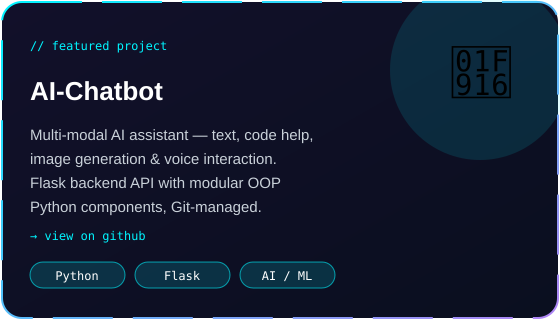
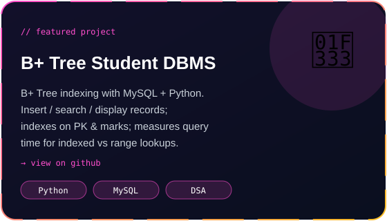

 

<h2 align="center">👨‍💻 About Me</h2>

B.Tech CSE student · Full-Stack, AI & Backend · I learn best by <b>shipping real projects</b>, not just studying theory.

<h2 align="center">⚡ Tech Arsenal</h2>

  

🌱 Currently exploring: <b>React · Express · AWS · MERN · Machine Learning</b>

<h2 align="center">🚀 Featured Projects</h2>

<h2 align="center">📦 Latest Repositories</h2>

<!-- AUTO-UPDATED by .github/workflows/Update repos.yml (every 6h + on push). Don't edit between markers. -->
<!--START_REPOS-->
**[sanc1213](https://github.com/sanc1213/sanc1213)** — My GitHub profile and developer portfolio  
`N/A` · ⭐ 1

**[AI-Chatbot](https://github.com/sanc1213/AI-Chatbot)** — Developed a multi-modal AI assistant capable of text conversations, code assistance, image generation, and voice-based interaction. Designed a Flask-based backend API architecture for handling AI services and frontend communication. Implemented modular Python components using OOP principles and managed source control using Git/GitHub.  
`Python` · ⭐ 1

**[B-Tree-Based-Student-Database-Management-System-DBMS-Mini-Project-B.Tech-CSE-](https://github.com/sanc1213/B-Tree-Based-Student-Database-Management-System-DBMS-Mini-Project-B.Tech-CSE-)** — This DBMS mini project demonstrates B+ Tree indexing using MySQL and Python. It manages student records with insert, search, and display operations. Indexes on primary key and marks improve query performance. The system measures execution time to compare indexed searches and range queries, showing how B+ Trees optimize data retrieval in databases.  
`HTML` · ⭐ 0

<!--END_REPOS-->

<h2 align="center">📊 GitHub Analytics</h2>

 

 

<h2 align="center">🧩 LeetCode</h2>

<h2 align="center">🐍 Contribution Snake & 3D Skyline</h2>

 

<h2 align="center">📚 Currently Learning</h2>

<h2 align="center">📫 Connect</h2>

 

